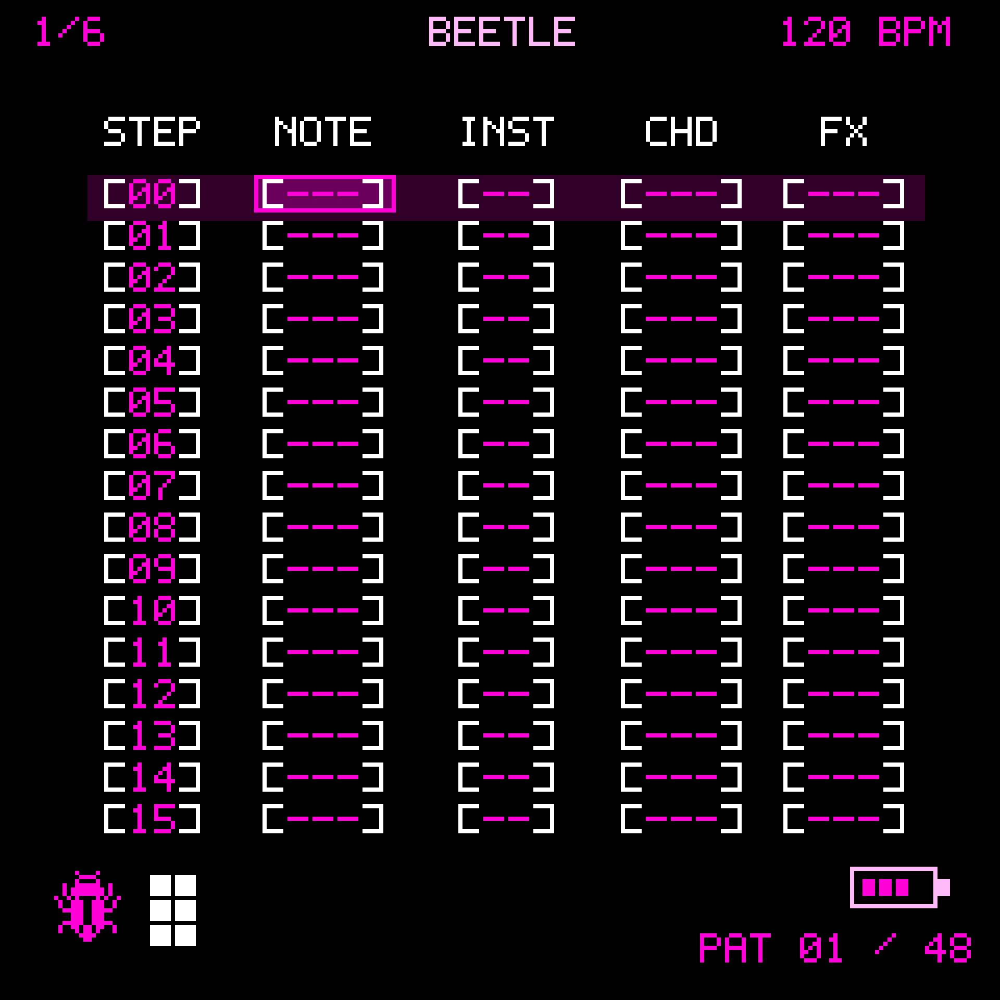

<p align="center">
  
</p>

<h1 align="center">BEETLE</h1>
<p align="center">
  <strong>An open-source six-lane tracker and digital drum machine for the M-VAVE FM1.</strong><br>
  SikkenWorks · Born out of passion.
</p>

<p align="center">
  <a href="https://sikkenworks.github.io/BEETLE/WebInstaller.html"></a>
  <a href="https://sikkenworks.github.io/BEETLE/simulator.html"></a>
  <a href="https://sikkenworks.github.io/BEETLE/BEETLE-Project-Manager.html"></a>
  <a href="https://sikkenworks.github.io/BEETLE/BEETLE-MANAGER.html"></a>
  <a href="https://thefirmwarehub.com/?q=sikkenworks"></a>
</p>

<p align="center">
  <sub>Development release: <strong>V1.4.35 EXPERIMENTAL</strong> · <a href="CHANGELOG.md">Release history</a></sub>
  <br>
  <b>The user sample feature is still experimental!</b>
</p>

---

<h2 align="center">USB MULTITRACK RECORDING + USER SAMPLES</h2>
<p align="center">
  <strong>Record BEETLE's six channels separately over USB-C, and play your own samples directly on the FM1.</strong><br>
  <sub>Both features are experimental and have not been fully validated on physical FM1 hardware.</sub>
</p>

| | |
| :-- | :-- |
| **6-track USB recording** | **Six independent mono tracks**, CH1–CH6, at **44.1 kHz / 16-bit** into a DAW. Enable **HOME → PROJECTS → SETTINGS → USB MULTITRACK → ON**. The stems are recorded before global MASTER and Punch-In FX, without mixer pan; switching OFF records the processed stereo master instead. |
| **13 global user samples** | Import your own WAV one-shots into **U01–U13** with the [Project Manager](https://sikkenworks.github.io/BEETLE/BEETLE-Project-Manager.html). These samples are shared by **all 12 projects** and supplement the 14 factory drum sounds. Requires **Storage V2** migration. |
| **Total sample duration** | **Approximately 10–20 seconds combined across all 13 slots** is the design target, **not 10–20 seconds per sample or a fixed guaranteed limit**. Small projects may leave room for around 20 seconds (sometimes more); large projects can leave substantially less, or no safe space for new samples. |
| **What determines the limit?** | The **288 KiB** FM1 volume is shared between the **12 saved projects** and global samples. Project sizes and compression, existing sample data, previous record generations, sector fragmentation, metadata and the mandatory free-space safety reserve all affect the amount available. |

**For scale:** BEETLE converts device samples to **22,050 Hz mono, 4-bit BD4S**. About **10 seconds need 114 KB** and **20 seconds need 227 KB**, before additional storage overhead. In software storage tests, a roughly 20-second combined sample bank fits alongside one larger and eleven smaller projects, but **20 seconds does not fit with twelve maximum-size projects**. The Project Manager / device storage checks determine what can actually be stored and refuse uploads that would compromise existing data.

Read [Global User Samples & Storage V2](#global-user-samples--storage-v2-v1424-experimental) and [USB-C audio capture](#usb-c-audio-capture-stereo-or-six-track-mode-experimental) for setup, limitations and safety information.

---

## New in V1.4.35: Punch-In Page Lights, SONG Loop Hold & Bulk Project ZIP

**Punch-In FX keys light up for the active Punch-In FX page.** The FM1 keyboard LEDs show all eight white keys corresponding to the eight effects visible on the currently selected Punch-In page, and the WebSimulator highlights that same bank. Changing from FX page 1 to page 2 changes the eight illuminated keys. Pressed keys remain visible, and the existing FX trigger, K1 parameter, multi-hold priority and paging rules are unchanged.

**In SONG CHAINS, hold SEL for at least 650 ms to toggle SONG LOOP ON/OFF.** The loop state is indicated by the existing SONG ON/OFF LOOP ON/OFF label. A short SEL press still clears the selected song range (or switches SONG ON/OFF if no range exists). Holding SEL while turning K1 still selects a song range and **does not toggle** the loop setting. The V1.4.34 rule remains: PLAY with a selected range loops *that selection*, independently of ordinary SONG LOOP; full-song playback follows the SONG LOOP switch.

**The Project Manager adds EXPORT PROJECTS ZIP and IMPORT PROJECTS ZIP**, alongside the original per-slot encrypted `.beetle` import/export. Bulk export reads and validates **all occupied project slots (maximum 12)**, encrypts their data into individual `.beetle` entries and writes a `PROJECTS-MANIFEST.json` with source slot, name, version, sizes and checksums. ZIP import validates the complete archive, header/central directory, manifest, duplicate/unsafe names, checksums, decrypts every project, checks each project's internal CRC and assigned slot and asks for **two separate confirmations before replacing stored projects**. It restores to the recorded slot numbers; entries absent from ZIP are untouched. Imports are sequential, verified by readback after each commit and **not atomic**; unplugging the FM1 partway through may leave a partial import. This ZIP contains *projects only*, **not global U01–U13 sample audio**: back up your user-sample bank separately with the existing sample-bank workflow. ZIPs are exported uncompressed (store-only) for predictable validation; other ZIP generators' compressed archives are not currently supported. Existing individual import/export functionality remains available.

**Legacy V23 migration regression test corrected:** the older test previously mislabeled V25 project bytes as V23 without removing eight later-added Punch-In settings. It now constructs a structurally valid V23 test project and tests that the current project decoder reads it. The production decoder and project schema **TRK1 V25** were not modified. The separate old PCM-reference checksum regression was already failing on the V1.4.34 baseline and is documented separately; it is not reported as passed.

Host tests confirm native SONG selection, V23 readback, ZIP round-trip and malformed-ZIP rejection, while the native JieLi app and FM1 `.fwsc` package verify. **No physical FM1 keyboard, MIDI, USB or OTA flashing test has been performed.** Back up projects and samples and use only a confirmed recovery route.

## New in V1.4.34: SONG Pattern Selection & Range Loop

In **SONG CHAINS**, navigate with **K1** (song row), **K2** (channel / repeats) and **K3** (pattern / repeat value). To select a passage, hold **SEL** and rotate **K1**: the anchor is the row at the moment SEL was pressed, and the selected inclusive range is displayed with the **same filled magenta strip and pink active-cell outline as tracker step selection**. Release SEL to leave the range highlighted. **PLAY immediately starts on the first selected row, and loops exactly those selected song rows until STOP**, even if the ordinary SONG LOOP switch is off. Every row's existing `REP` count is respected. The visible playback position follows the selected rows. This also works when selecting backwards and for a single-row range. If SONG was off, selection+PLAY activates it to perform the selected-song loop.

**SEL alone** clears an existing range without toggling SONG. When no range is present, SEL continues to toggle SONG ON/OFF. **SEQ+OP1/2** still copy/paste selected song rows, and **OCT+/-** insert/delete rows (doing so clears the transient selection to avoid stale positions). During PLAY the song-chain rows cannot be edited or inserted/deleted, avoiding races with the realtime audio engine. **Without a selected range, PLAY preserves normal full-song mode and its existing global LOOP setting.** The range is a temporary UI/playback state, not a saved song arrangement change.

The standalone WebSimulator and the All-in-One Manager mirror the same range playback and selection highlighting. No changes to `.beetle` serialization (**TRK1 V25**), channel routing, Punch-In, usersamples, NOTE2, SID, USB stereo/multitrack, or OTA loader. Host range-loop tests, native JieLi build and firmware/embedded-content integrity checks passed; hardware flashing and real-time playback are still experimental. Back up projects and samples before attempting OTA.

## New in V1.4.33: Live CHD Chord Audition

On the **TRACKER** screen, enter a note on a synth channel (CH1–CH5), select **CHD** using K2, then rotate **K3**. Every change now plays the saved note as the currently selected chord **immediately**, without needing PLAY or a separate key press. This previews all twelve chord choices, from a single note (`---`) to five-note `MIN9`, with the step's saved instrument and current keylock voicing. Turning K3 again releases the prior chord before starting the next; the audition automatically releases after approximately 240 ms.

**Non-destructive:** the audition never adds tracker notes, changes any other step, advances the playhead or alters recording state. It stays silent for EMPTY/STP notes, CH6 drums and when the transport is running. The existing global **MONO** mode permits only its normal single-voice preview; use POLY to hear all notes simultaneously. The user's currently selected CHD value is, of course, saved normally just as before. Normal NOTE scrolling continues to preview one note.

**Compatibility:** no new project fields, flash sectors, MIDI messages or USB buffers. TRK1 V25 projects, user samples, NOTE2, stereo/multitrack recording, SID upgrades and protected OTA assets are retained. Native build and host chord-policy tests pass, and firmware packaging was checked against V1.4.32. Physical FM1 audio/OTA flashing remains unverified.

## New in V1.4.32: USB-C Audio Capture Stability (experimental)

**Both stereo USB recording and the six-track multitrack stream** now use a larger *time reserve* in the same 512-frame capture ring. Priming increases from 104 to **224 samples at 44.1 kHz**, providing more time for an occasional late DMA render without allocating extra PCM RAM. The nominal USB capture delay rises by approximately **2.72 ms**. The optional, experimental 48 kHz stereo path uses a corresponding 244-frame reserve.

The former stereo clock controller (up to ±0.6% and comparatively rapid retuning) has been replaced with the slower bounded controller already used for multitrack (up to ±0.098% nominal rate correction), measured once per native audio render. Both modes continue transmitting their correct 44/45 frames per USB millisecond and use one shared sample clock across all six stems.

**Error recovery is explicit:** a true underrun tapers the final audible PCM values towards silence within the affected packet, then requests a fresh ring prime at the next DMA boundary, resetting fractional-read state and SRC control. An overrun also requests this bounded restart, instead of silently dropping successive full audio blocks and retaining stale read positions. A 24-frame fade-in avoids a large discontinuity where the priming silence meets resumed audio. Writer free-space checks explicitly reject impossible read/write distances. The **RECOV** counter on SYSTEM → USB AUDIO reports these restarts, alongside UND / OVER / STALL. The hardware ISR, USB endpoint and actual worst-case latency have **not** been validated on a physical FM1.

**What has not changed:** all BEETLE synths/SID fixes, patches, Punch-In FX, project and sample formats, user samples, NOTE2, six stems, protected OTA boot sections and stored projects. This release does not increase the number of voices or blindly remove overload safeguards. If the underlying audio renderer misses its deadline repeatedly, the recorder can still contain audible gaps; the new logic avoids indefinite holds and repeated stale-buffer processing but cannot reconstruct missing audio.

Validation: 10-minute steady-state stereo and multitrack host clocks without loss; six-minute simulated DMA delays and USB host-read interruptions, with recovery; signed PCM16 fades, overflow guards, existing DSP/NOTE2 regressions, native JieLi compilation, firmware asset checks. These are **software tests**, not physical USB recording proof.

## New in V1.4.31: SID Wah / Beating Regression Fix

The V1.4.30 SID upgrade unintentionally made factory-style **SID 6581, SID DIRTY and SID BASS** patches sound as if a wah/filter sweep were running, even with no modulation enabled. It activated a pre-existing **12-cent VA default detune** on oscillator B, which previously shared the same oscillator phase; meanwhile the replacement 6581 cutoff mapping raised the usual cutoff setting of 96 from approximately 37 to approximately 97 (Q8 filter coefficient). **V1.4.31 corrects both.**

For those three 6581-derived variants, neutral oscillator B settings (`coarse B = 0`, `fine B = 0`, `detune = 12` from older defaults, or `0`) now keep the two phases coherent. Deliberate B tuning, Hard Sync or Ring Mod still use the independent B oscillator. The earlier V1.4.29 **6581 cutoff/resonance mapping** is restored, preserving older patches' tonal balance. **SID 8580 and SID NOISE remain unchanged** relative to V1.4.30. Combined waveforms, Hard Sync, Ring Mod and the faster 32-bit filter implementation remain available.

No project migration, additional audiobuffer or permanent RAM allocation is required. This is a source/host-validated correction; the result still needs listening tests and sustained stress testing on a physical FM1 before the firmware can be considered reliable.

## New in V1.4.30: SID Character & Boot Keyboard Isolation

**SID 6581 / SID 8580:** separate 17-point ROM cutoff curves, safer 32-bit fixed-point filter processing (three former 64-bit multiplications per SID sample removed), and **two independently running A/B oscillator phases**. This adds useful tonal and filter differences while keeping the existing eight shared synthvoices and project file format **TRK1 V25**.

In **EDIT → OSC → Bank 3**, SID patches now reuse three previously SID-inactive parameters: **HARD SYNC** (the former SUB OSC knob), **RING MOD** (formerly NOISE, active when oscillator A is TRIANGLE), and **COMBINE** (formerly FM DEPTH, 0–100%). COMBINE blends a SID-inspired masked A/B waveform with the normal linear mix. All default to OFF on unchanged presets. These are lightweight **SID-inspired models**, not a cycle-accurate original MOS 6581/8580 or reSID. The browser simulator only approximates the native audio implementation.

**Boot project keyboard fix:** musical key presses while **NEW PROJECT / LOAD PROJECT** and related modal confirmation/loading screens are open are discarded; keys held across the exit are ignored until released. They can no longer unexpectedly insert notes or trigger SEQ musical-key shortcuts on returning to the tracker. Freshly pressed keys in the tracker still work normally.

**Compatibility & safety:** existing projects, the instrument library, 13 global user-sample slots, NOTE2, Punch-In FX, USB capture, sample capacity protections, and retained OTA loader/header are unchanged. The new SID filter curves intentionally change the audio timbre of existing SID patches. JieLi builds and host tests are software-only; hardware stability and OTA recovery remain unverified. Make independent project/sample backups and confirm a working recovery path before flashing experimental firmware.

## New in V1.4.28: User-Sample Streaming Optimization

**Faster, lower-overhead global user-sample playback.** The native 22,050 Hz BD4S streamer now reuses the source sample pair across each two 44,100 Hz output frames instead of repeating PCM-window searches on both frames. Full 256-frame encoded blocks are obtained with a single bounded background flash read, instead of a separate six-byte header read and second full-block fetch. Short final blocks remain bounds-checked. The six-channel drum mixer also bypasses unnecessary factory-ROM 64-bit interpolation for global user samples, which are already resampled in the BD4S engine.

**No new sample storage format, no new flash partition, no extra drum voices, and no changes to user sample labels or NOTE2 mapping.** All 13 global user samples, six drum voices, Punch-In FX, USB stereo/multitrack, Storage V2 safety margins and project schema **TRK1 V25** are preserved. Existing `.beetlebank` and `.beetle` files remain in their existing formats.

**Software validation:** 64 consecutive pattern-loop retriggers across six independent sample voices, exact PCM comparison, long six-voice playback, underrun/recovery tests, and live Storage V2 stream tests pass on the host. The native JieLi/USB/Storage V2 build and firmware packaging have passed software checks. **This does not yet demonstrate that physical FM1 looping glitches, CPU/DMA overload or USB recording issues have been resolved**; test on real hardware with backed-up projects and a known-working recovery path.

## New in V1.4.27: CRY, Audible BITCRUSH & RADIO Low-Cut

**CRY** is the new name for the former **SCRATCH** Punch-In effect (FX 09). Its effect ID, held-key mapping, captured performance automation and parameters are unchanged. It is still short-buffer, bidirectional scratch playback rather than a long, full reverse track. The firmware Punch-In pages, recorded FX event editor and WebSimulator display **CRY**.

**BITCRUSH (FX 10)** now combines real **12-to-4-bit quantization** with **sample-rate reduction (44.1 kHz down to approximately 1.4 kHz at maximum)**. Hold its white key and turn **K1**: at 50 the native engine produces roughly **8-bit / 2.76 kHz** processing, deliberately more audible on quiet patches and drums than the previous amplitude-only version. State persists across DMA blocks, while short wet/dry fades avoid abrupt clicks. This is deliberately aggressive digital degradation at higher settings.

**RADIO (FX 15)** now uses **two high-pass stages** for a clearly audible low-cut, preserving upper frequencies without a telephone-style low-pass. K1 raises the bass cutoff and gradually increases a small stereo hiss component. The source music is retained; this is **not** noise-only playback. A short transition fades the effect in/out.

**Verification:** a new host-native DSP regression checks quiet-signal BITCRUSH, 200 Hz vs 3 kHz RADIO attenuation, and that idle hiss remains low. It also checks NOTE2 / sample compatibility from V1.4.26. **The physical FM1, live CPU deadline, USB audio and OTA recovery still need real-device validation**. Back up before flashing; a successful native build does not certify the hardware.

## New in V1.4.26: Punch-In DSP, User Sample Looping & NOTE2

**Audio effects corrected:** CRY now makes a fast back-and-forth movement through the existing short stereo history, with forward and reverse playback speed controlled by K1. BITCRUSH always reduces the effective bit depth rather than reaching an inaudible 16-bit setting. PHASER now cascades four all-pass stages and mixes wet/dry for moving phase notches. RADIO applies a distinct voice-band EQ with subdued noise, and DJ ISOLATOR uses separate bass, mid and treble components for audible band kills. The other Punch-In FX, both pages and automatic last-held-key focus remain intact.

**Global U01–U13 samples on CH6 NOTE2:** NOTE2 now accepts **all 14 factory drums plus all 13 user samples**, just like NOTE1. Use **K2** to focus NOTE2 and **K3** to scroll through factory and U01–U13 choices, or press a drum key with Tracker REC armed to write into NOTE2. NOTE1 remains unaffected. NOTE2 keeps separate step FX. Existing NOTE2 factory hits and STOP commands continue to decode, and the project schema remains TRK1 **V25**. **Compatibility warning:** V1.4.25 firmware rejects a saved project containing the new U01–U13 NOTE2 encoding, despite sharing the V25 schema. Back up the project and remove or replace those NOTE2 hits before downgrading. This does not affect projects using only the original factory NOTE2 hits.

**Looping sample stability:** the native Storage V2 BD4S streamer now reuses previously verified sectors and avoids redundant flash reads when up to six drumvoices retrigger in short patterns. This reduces unnecessary flash traffic without increasing audio buffer size, changing the 22,050 Hz / 4-bit sample format, or reducing synth polyphony. The WebSimulator reflects NOTE2 editing but does not have direct access to global samples stored on a physical FM1.

**Firmware safety:** see [`docs/V1426-PUNCH-FX-NOTE2-SAMPLE-STABILITY.md`](docs/V1426-PUNCH-FX-NOTE2-SAMPLE-STABILITY.md) for the fix details and real-hardware test procedure. This is an experimental source and software-tested firmware update. The protected 16 KiB header, original OTA loader, device identity `FM-1_2123`, Storage V2 protocol and sample/project reserve are retained. **Actual FM1 sound, USB multitrack stability, sustained DSP load, flash update success and hardware recovery are not yet validated.** Export project/sample backups before any update.

## New in V1.4.25: Sixteen Punch-In FX & Custom Sample Labels

**PUNCH-IN FX now has two pages with 16 playable white-key effects.** Page 1 retains REPEAT, RING MOD, FILTER, TAPE STOP, STUTTER, OCT UP, OCT DOWN and MUTE. Page 2 adds **CRY, BITCRUSH, PUMP, GLITCH, WOW, PHASER, RADIO and DJ ISOLATOR**. Press **FX** to cycle through Per-Step FX, Punch-In 1/2 and Punch-In 2/2. The display **automatically jumps to the page of the most recently pressed Punch-In key**, regardless of the currently shown page. If that key is released while another remains held, the display switches back to the most recently held effect. Hold a parameterized key and turn **K1** to adjust its live setting. Existing REVERSE is *not* reintroduced: CRY uses bounded bidirectional movement through a short shared audio buffer rather than promising full-length reverse playback.

**GLOBAL SAMPLE LIBRARY labels are now editable in the Project Manager**. Each U01–U13 slot can have its own **three-character tracker label**, such as `KIK`, `SN2` or `!FX`. These labels are saved to `.beetlebank` V2 with backward-compatible loading of V1 banks, and are transferred alongside sample data to compatible Storage V2 firmware. Labels are global, not stored separately in each project; the default labels remain U01–U13. The short name is distinct from the full PC-side WAV filename/sample name. Samples must be uploaded again for edited labels to appear on the FM1.

**Project format:** TRK1 **V25** stores the additional Punch-In parameters and full sixteen-effect event IDs. Supported older projects, including V24, remain readable, but older firmware cannot read newly saved V25 projects. Back up projects before upgrading or downgrading. The updated 32-bit Punch-In interpolation avoids the former 64-bit per-sample multiply without reducing interpolation precision. The existing shared audio history is retained rather than enlarging RAM buffers.

**Development warning:** native compilation and software tests are not physical FM1 performance measurements. Simultaneous heavy FX, user samples, USB multitrack, timing and OTA recovery remain hardware-unverified. Storage V2 migration is destructive and requires independent verified backups.

**V1.4.29 RETRO PULSE sustain correction (source patch):** Removed the 4-bit quantization of the ADSR envelope, which could cause audible stepped amplitude during sustained notes. The original eight-step Game Boy-style duty oscillator is preserved, but its known duty cycle is now centered directly instead of relying on a slow DC tracking filter. A small voice-local smoothing stage reduces high-frequency edge harshness without allocating any new audio buffer. An automated host PCM test confirms stable voice identity, sustained output, negligible DC and note-off release. Physical FM1 listening and timing tests are still required. **No new flashable firmware has been validated in this source-only build.**

## What is BEETLE?

BEETLE turns the **M-VAVE FM1** into a standalone, hands-on music workstation. Compose patterns, play the built-in keyboard, design instruments, program drums, arrange songs and perform with live effects, all using the FM1's own controls.

| | |
| :-- | :-- |
| **6 channels** | CH1–CH5: synthesizers · CH6: digital drums with two hits per step |
| **48 patterns** | 1–16 steps per pattern, with independent channel content |
| **Song Chains** | 64 song positions with a separate pattern source for each channel |
| **Sound engine** | Up to eight shared synth voices, six drum voices, 14 built-in drum sounds |
| **User samples** | 13 additional CH6 one-shot slots (U01–U13), shared across projects after Storage V2 migration; experimental |
| **Sound design** | Eight active synth instrument patches, 12 selectable oscillator types, two VA oscillator modes, plus eight project-local library presets |
| **Performance** | Mixer, mute/solo, Punch-In FX, snapshots and mute groups |
| **Projects** | 12 project slots, TRK1 V25 project format, encrypted `.beetle` backups and an optional shared Storage V2 volume |

## Where to Start

You can learn the workflow in a few minutes using the [Web Simulator](https://sikkenworks.github.io/BEETLE/simulator.html), or follow the same controls on an FM1 running BEETLE.

1. **Open the tracker.** Press **SEQ**. This is your main editing screen.
2. **Choose a channel.** Turn **SELECT**: CH1–CH5 are synth lanes; CH6 is the drum lane. Turning left from CH1 also reaches the recorded Punch-In event lane.
3. **Pick a pattern.** Turn **ALGORITHM** to choose one of the 48 patterns while stopped.
4. **Move around the grid.** Turn **K1** for the step (row) and **K2** for the field (column). Turn **K3** to change the selected value.
5. **Enter a sound.** With Tracker **REC ON**, press a musical key to write a note or drum hit. Press **REC** to toggle note writing; with **REC OFF**, the keys only audition sounds. The tracker normally advances after the main note is entered. On CH6, selecting **NOTE2** with K2 lets you enter a second drum hit without overwriting NOTE1 or advancing the step.
6. **Correct mistakes.** **SEL** clears the selected step. **ENV** inserts a note stop (`[STP]`) in the focused note field; it is *not* the same as clearing the entire step. Use **SEQ + OP5** to undo an edit.
7. **Play it back.** Press **PLAY/STOP**. Change the tempo with **K4**. Stop playback before making structural edits.
8. **Build the sound and arrangement.** Press **EDIT** for instruments, **GLO** for the mixer, **LFO** for master effects, or **ARP** for Song Chains. In Song Chains, hold **SEL** and turn **K1** to select rows; **SEQ + OP1 / OP2** copies/pastes them. Press **SEQ** to return to the tracker.
9. **Save your work.** Press **SAVE**, or open **HOME → SAVE / SAVE AS** to manage a project slot.

> **FM1 terminology:** **SEL** means the physical SELECT push-button; **SELECT** in this guide means the *rotary encoder*. **OP1–OP6** are the six mapped black musical keys used with **SEQ**. The function of some controls changes with the current screen.

## HELP chapters

Press **HOME → HELP**. Turn **K2** to browse the thirteen topics. Turn **K1** to scroll *inside the selected chapter*. The scroll position resets at each chapter change, and the bottom counter refers to the current chapter, not the whole manual. **HOME** returns to Projects and **SEQ** returns to Tracker. HELP remains read-only; turning the other encoders will not edit your music.

Chapters: Tracker Basics, Pattern Editing, Step Dynamics / Groove, Instrument / Keyboard, Projects, Live FX / Record, Song Chains, Live Mixer / Solo, Mixer / Performance, Master FX, Guide / Navigation, Block Instrument / Delete and USB-C Audio.

## Global User Samples & Storage V2 (V1.4.24, experimental)

BEETLE has **14 built-in digital drum sounds** and **13 additional global one-shot slots, U01–U13**, assigned to CH6 drum note IDs **14–26**. The global bank is independent of individual `.beetle` projects: when it is stored on a compatible FM1, the same U-slots are available to all twelve projects. The native playback path uses the existing **six drum voices**, not extra synth voices. Global sample playback requires a **successfully migrated Storage V2 volume**; installing V1.4.24 firmware alone does not activate samples on a legacy A/B volume.

The [BEETLE Project Manager](https://sikkenworks.github.io/BEETLE/BEETLE-Project-Manager.html) includes a **GLOBAL SAMPLE LIBRARY**. Open or build a `.beetlebank`, import/replace/delete WAVs in U01–U13, and **SAVE GLOBAL LIBRARY** to keep your original WAV files in a portable computer backup. On a connected Storage V2 FM1, choose **UPLOAD PC WAVs · KEEP OTHER FM1 SLOTS** to transfer only the WAV slots you have loaded locally. The manager converts device-bound WAVs to BEETLE's **22,050 Hz mono, 4-bit BD4S** format and verifies their transfers. The `.beetlebank` computer-file limit is **not** the FM1's capacity; available sample duration depends on occupied flash space and the twelve projects. A full volume rejects new writes instead of silently replacing saved data.

**V1.4.25 Project Manager sample-safety update:** On every connection, all 13 FM1 sample slots are scanned read-only. The display distinguishes **STORED ON FM1** from **PC WAV NOT LOADED**, including after reconnecting. Empty PC slots now **preserve existing device samples** rather than deleting them. Only explicitly loaded WAV slots are eligible for upload; any occupied device slot that would be replaced requires separate confirmation. To erase a sample from the FM1, use the individual **DELETE ON FM1** control with backup acknowledgment. If the device scan fails, uploads are blocked. Note that the currently installed native protocol only exposes device occupancy, byte count and CRC/generation: **it cannot download the original WAV or read back its 3-character tracker label**. Keep your `.beetlebank` original backup. The fix changes only browser tools and requires **no firmware reflash**.

### Migrating an existing FM1 to Storage V2

1. **Back up your projects first.** Save any existing `.beetle` and `.beetlebank` files on your computer. Keep a separate, independently verified firmware/flash recovery option.
2. Connect an FM1 running **BEETLE V1.4.24 with Project Transfer V5** to the Project Manager using a USB data cable and supported USB-MIDI browser permissions. Choose **CHECK STORAGE STATUS**.
3. If **LEGACY A/B** is reported, use **CONVERT STORAGE TO V2**. The manager scans all twelve slots, exports their encrypted project backups to a ZIP, and requires you to **verify that ZIP really exists on your computer** before confirming the destructive conversion.
4. The manager checks the original slot fingerprint, initializes **only the BEETLE project/sample flash volume**, restores saved projects as **TRK1 V24**, reads them back and checks all twelve slots. Do not disconnect the FM1 or interrupt power during conversion.
5. If restoration is interrupted after a successful V2 initialization, use **RESTORE V2 BACKUP ZIP** or import the backed-up `.beetle` files into their original slots. **Do not reformat again just to retry restoration.**
6. Once **STORAGE V2 READY** is confirmed, transfer U01–U13 using **STORE U01–U13 ON FM1**, then select those notes from CH6.

**Important:** V1.4.24's conversion **erases the previous BEETLE-owned project volume** before restoring it and is **not an atomic or power-loss-safe migration**. A failed conversion may leave some or all projects unavailable until restored from the computer backup. Firmware recovery, physical flash/USB behavior and heavy-load DPCM4 sample playback have **not been validated on a real FM1**. See [`docs/V1424-STORAGE-MIGRATION.md`](docs/V1424-STORAGE-MIGRATION.md) and [`docs/V1422-GLOBAL-SAMPLES-NATIVE-RELEASE.md`](docs/V1422-GLOBAL-SAMPLES-NATIVE-RELEASE.md).

### Project-reserved sample capacity meter (V1.4.25 storage-safety variant)

The Project Manager includes an **FM1 SAMPLE SPACE** bar. With firmware supporting the read-only `0x76` capacity command, it shows current compressed sample bytes, an estimate of remaining flash pages usable for samples, plus an explicit **32 KiB (eight-sector) project reserve and 16 KiB (four-sector) recovery guard**. The new firmware refuses a sample upload during preflight if it would violate those limits, before programming flash. This is a *minimum* allowance for future project saving, **not** a guarantee that every full-size future project will always fit: project size, journal generations, fragmentation and flash wear matter.

BEETLE V1.4.24 and earlier V1.4.25 firmware builds lack the read-only capacity command and the new project-reserve enforcement. The Manager labels their available sample capacity **NOT VERIFIED**, rather than inventing a free-space percentage; its existing safe sample inventory and explicit replacements still work. On those older builds, uploading many samples may leave too little space for future project saves. Update firmware only with a tested recovery path; do not interpret successful software builds as validation on a physical FM1. The `.beetlebank` PC-file capacity is distinct from real FM1 flash space.

## USB-C audio capture: stereo or six-track mode (experimental)

Connect the FM1 with a **USB-C data cable**. On Windows, open **Settings → System → Sound → Input** or the audio input selector in a recording application and choose **BEETLE Audio** (device naming depends on the operating system). Set the recording format to **44,100 Hz, 16-bit**; use stereo for USB MULTITRACK OFF or six mono inputs for ON when the host DAW/driver supports them. Start playback on the FM1 and recording on the computer. The computer initiates the USB audio stream; there is no extra on-device enable switch. The stream taps BEETLE's final master stereo signal, including the master volume, and leaves the analog output and USB-MIDI path present.

USB-C audio is **audio from FM1 → computer**, not computer → FM1. It is not USB screen capture, audio-file transfer or USB mass storage. **Multitrack ON provides six independent mono channels before global master processing; OFF captures the stereo master.** The WebSimulator produces local browser audio and **does not act as a physical USB audio device**.

The USB audio endpoint and associated ISR originated from Felucca. BEETLE retains the **44.1 kHz USB Audio Class 1** stereo and six-channel capture paths. Later V1.3.9/V1.4.1 work revised clock-drift correction and six-stem interpolation to reduce timing fluctuations; this does **not** establish sample-accurate, glitch-free recordings on physical hardware. Both modes remain **software-/linker-validated and experimental**, not proof that Windows/macOS/Linux enumerates them correctly or that all six lanes, effects and USB recording run without DMA deadline misses. Check for a BEETLE Audio input after installing; if the device fails to enumerate, do not assume an OS-level driver change will fix the firmware. See [`docs/V1.2-AUDIO-VALIDATION.md`](docs/V1.2-AUDIO-VALIDATION.md) and [`CHANGELOG.md`](CHANGELOG.md).

Build the distributed USB-audio configuration with:

```bash
export JIELI_TOOLCHAIN=/path/to/jieli-linux-toolchain
python firmware/fm1-native/build.py --beetle-storage-lab --updater --usb-audio --beetle-v2
```

The V1.4.24 `.fwsc` retains the existing protected boot header and OTA loader, and reports the established `FM-1_2123` identity. It includes experimental Storage V2, sample transfer and audio support; a working independent recovery route and physical FM1 validation are still required before treating it as safe for everyday use.

## FM1 Controls

### Buttons

Every dedicated button is listed here with its role in BEETLE.

| FM1 button | What it does in BEETLE |
| :-- | :-- |
| **FX** | Opens **Per-Step FX** for the selected step. Press again to reach **Punch-In FX**. In the Performance screen, opens **Mute Groups**. |
| **SEL** | In the tracker, **clears the selected step** on release. Elsewhere it confirms a choice, toggles an option or applies the screen's highlighted action. Hold it and rotate K1 in the tracker to select a range. |
| **ENV** | **Stops the selected note** by writing `[STP]` in the focused NOTE or drum NOTE2 field. This is a note-stop command, not full step deletion. |
| **LFO** | Opens **MASTER FX**: EQ, compressor and reverb. |
| **EDIT** | Opens the **Instrument Editor**. Press again to reach the drum component editor where applicable. |
| **GLO** | Opens or closes the regular **Mixer**. |
| **HOME** | Opens **Projects** for New, Save, Load, Help and related tools. **Hold HOME** to open the Scale Guide. |
| **SAVE** | Opens the project save workflow or saves the current named project. |
| **ARP** | Opens **Song Chains**. When SONG is enabled, pressing ARP from Song Chains opens the **Live Mixer**; pressing again returns to Song Chains. |
| **SEQ** | Returns to the **Tracker** and acts as the modifier for editing shortcuts. |
| **PLAY/STOP** | Starts or stops playback. When SONG is enabled, playback follows the Song Chain. |
| **REC** | In Tracker and ordinary screens, toggles **note/step writing** (default ON); OFF still auditions without writing. In **Step FX / Punch-In FX**, independently toggles **Punch-In recording** for held performance effects. Leaving those FX pages ends Punch-In recording without changing Tracker REC. |
| **OCT− / OCT+** | Changes the live keyboard octave (−4 to +3) when no saved note/range is being edited. In Tracker with playback stopped and REC disarmed, transposes the focused synth note or selected range by ±12 semitones. On Song Chains, removes/adds a song position. Other screens may assign contextual actions. |

### Rotary encoders

| Encoder | Primary function | Other important uses |
| :-- | :-- | :-- |
| **SELECT** | Choose CH1–CH6 in the Tracker; rotating left from CH1 also reaches the recorded Punch-In event lane. | Choose MASTER FX blocks or drum components on their respective screens. |
| **ALGORITHM** | Select patterns **01–48** in the Tracker. | **SEQ + ALGORITHM** shifts the selected lane's steps up/down while stopped. |
| **PRESET** | Cycle a focused NOTE through **note / `[---]` (empty) / `[STP]` (stop)**. | On CH6 NOTE2, cycles its second-hit value, empty and stop states. |
| **K1** | Move vertically through tracker steps. | **Hold SEL + K1** to mark a tracker step range or a Song Chain row range; adjust an active Punch-In effect parameter while its key is held. |
| **K2** | Move horizontally between tracker fields. | Select columns, parameters and Song Chain sources. |
| **K3** | Change the focused tracker value. | Edit the selected parameter in most BEETLE editors. |
| **K4** | Change tempo (BPM). | **SEQ + K4** sets pattern length while stopped; contextually selects project slots or adjusts a MASTER FX parameter. |

**Punch-In parameter note:** The current native firmware uses **K1**, not ALGORITHM, to adjust an effect while its Punch-In key is held. **REC** has separate Tracker-note and Punch-In-recording states. The physical REC LED follows the corresponding mode; the Tracker no longer shows the old `REC ON` / `REC OFF` text. Song Chain keyboard LEDs also indicate the selected channel's sounding notes/drum triggers; these behaviors remain hardware-unverified.

### Musical keys

| Where | What the keyboard does |
| :-- | :-- |
| **Tracker / CH1–CH5** | With Tracker REC armed, enter synth notes even if another column has focus; existing instrument/chord/FX fields are preserved. With REC OFF, audition only. |
| **Tracker / CH6** | With REC armed, enter a drum in NOTE1, or a separate second hit (factory drum or U01–U13) when **NOTE2** is focused. The original 14 factory hits are retained; U01–U13 (drum IDs 14–26) require the experimental global Storage V2 sample bank. REC OFF auditions without writing. |
| **Instrument Editor** | Audition the selected synth patch without adding tracker notes. |
| **Drum Editor** | Audition the selected drum component. |
| **Mixer / Live Mixer** | The six assigned **black keys mute CH1–CH6**; their six corresponding **white keys solo CH1–CH6**. LEDs reflect active mute/solo states. |
| **Punch-In FX / Punch-In REC armed** | Eight assigned white keys, from left to right, hold the eight performance effects. Release the key to end the held effect. Punch-In recording is separate from Tracker note recording. |

### Editing shortcuts

These combinations apply in the **Tracker** unless another screen is specified. Most destructive editing requires playback to be stopped.

| Hold / press | Result |
| :-- | :-- |
| **SEQ + OP1** | Copy the current lane, or the selected step range if a range is active. |
| **SEQ + OP2** | Paste the copied lane or range at the appropriate destination. |
| **SEQ + OP3** | Copy the complete six-channel pattern and recorded Punch-In events. |
| **SEQ + OP4** | Paste the complete pattern and Punch-In events. |
| **SEQ + OP5 / OP6** | Undo / Redo. The available undo history lives in RAM. |
| **Hold SEL + turn K1** | Select an inclusive range of tracker steps for copy/paste, deletion, instrument changes and octave transposition. In Song Chains, select contiguous song rows instead. |
| **SEQ + SEL** | Open **Block Editing** (Tracker), or **Performance Snapshots** (Mixer). |
| **SEQ + FX** | Open **Step Dynamics** (velocity and gate). |
| **SEQ + ENV** | Open **Step Groove** (microtiming, ratchets and probability). |
| **SEQ + OCT− / OCT+** | Transpose the saved synth note at the cursor down/up one octave, with preview. |
| **SEQ + K4** | Change the current pattern length (1–16 steps) while stopped. |
| **SEQ + ALGORITHM** | Rotate the selected channel's step data upward/downward while stopped. |
| **SEQ + EDIT** | Open the eight-slot **Instrument Library** from the Instrument Editor. |
| **Song Chains: SEQ + OP1 / OP2** | Copy / paste the selected Song Chain row or inclusive range, with Undo support and the 64-position limit. |
| **Tracker: OCT− / OCT+** | With playback stopped and REC disarmed, transpose the note under the cursor or all notes in the selected range by an octave; leave empty and `[STP]` steps unchanged. |
| **SEQ + rightmost black key (F#5)** | Open **CLEAR CURRENT LANE**. K1 selects YES/NO, SEL confirms; HOME cancels. Erases only the current channel in the current pattern; supports Undo. |
| **OCT− + OCT+ in EDIT** | Toggle instrument **MONO/POLY** without changing keyboard octave. |

## The Main Screens

### Tracker

Each pattern holds up to 16 steps for each of six lanes. The highlighted cell is edited with K1/K2/K3; with Tracker **REC armed**, the keyboard enters notes. REC OFF auditions sounds without altering the pattern. `[---]` means no new note, while `[STP]` ends a sounding note. **CH6** has independent NOTE1 and NOTE2 drum hits and their own step FX, with thirteen additional U-slots available after global sample-bank setup. Hold **SEL + K1** to select a range for copying, editing, deletion or transposition. Use **FX** for effects and **SEQ + FX / ENV** for step dynamics and groove. The tracker and Song Chain playhead have incremental LCD updates intended to keep the highlighted step synchronized; physical LCD/audio-load validation is still pending.

### Instrument Editor and Library

Press **EDIT** to adjust synth types, oscillators, envelopes, filters and patch settings. BEETLE includes VA, SID-inspired and NES-inspired sound types. Instrument settings are independent across eight active patch slots. In EDIT MONO, the keyboard uses last-note priority and returns to an earlier still-held note; rapid note transitions no longer use the former 45 ms note-on rejection. The **Instrument Library** (SEQ + EDIT) keeps eight named patches *inside the current project*; its STORE, LOAD, COPY and RENAME actions use K1 for slot, K2 for action, K3 for active instrument, K4 for copy destination, and SEL to execute. Save the project to keep library changes.

### Mixer and Live Mixer

Press **GLO** for the regular six-lane mixer: volume (0–120%), pan, mute, solo and swing. K1 selects a lane, K2 selects its parameter and K3 edits it. **SEL** toggles quantized mutes. With quantization enabled, mute changes during playback take effect at the next pattern boundary; otherwise they are immediate. New projects start with synth lane volume 50%, drum lane volume 80% and regular-mixer quantized mutes OFF.

The **Live Mixer** is separate and only available when **SONG is ON**. Its mute/solo changes are temporary performance overrides, not edits to the persistent mixer. **OCT−** toggles live quantized mute and **OCT+** toggles live quantized solo independently; both default ON. Its mapped black keys mute lanes and the matching white keys solo them.

From the regular Mixer, **SEQ + SEL** opens four **Performance Snapshots** (K1 slot, K2 save, K3/SEL recall). Press **FX** there to enter **Mute Groups**: K1 chooses one of four groups, K2 chooses its member lane, SEL adds/removes membership and K3 toggles the whole group. Both features follow the mixer's quantization behavior during playback.

### MASTER FX

Press **LFO** for the master effects chain. Turn **SELECT** to focus **EQ**, **Compressor** or **Reverb**; turn **K1–K4** to adjust the block's four parameters; press **SEL** to enable/disable it. Hold **SEQ** and turn **K4** to change processing order. Master effects apply to the overall output.

### Punch-In FX

Press **FX** to move between Per-Step FX, **PUNCH-IN 1/2** and **PUNCH-IN 2/2**. The **first eight white keys** trigger the original effects; the **next eight white keys** trigger the new effects, regardless of which page is visible. Pressing an FX key immediately shows its page. If you hold several, the most recently pressed effect takes display focus; releasing it restores focus to the latest still-held effect. Hold the key and turn **K1** to adjust its setting. **REC on either Punch-In page** arms performance-FX recording independently of Tracker note recording.

| Page | Effect | Behavior / K1 parameter |
| :-- | :-- | :-- |
| **1/2** | **REPEAT** | Loop captured audio; K1 adjusts fragment length. |
| **1/2** | **RING MOD** | Ring-modulate the mix; K1 controls intensity. |
| **1/2** | **FILTER** | Live filter; K1 adjusts frequency/character. |
| **1/2** | **TAPE STOP** | Slow and pitch-drop a captured fragment; K1 changes the slowdown duration. |
| **1/2** | **STUTTER** | Rhythmic audio gate; K1 selects the tempo-related rate. |
| **1/2** | **OCT UP** | Temporary pitch-shift up; no K1 parameter. |
| **1/2** | **OCT DOWN** | Temporary pitch-shift down; no K1 parameter. |
| **1/2** | **MUTE** | Temporarily mute the mix; no K1 parameter. |
| **2/2** | **CRY** | Bidirectional transport of a short frozen audio fragment; K1 changes the scratch movement. Not a long-record scratch. |
| **2/2** | **BITCRUSH** | Reduce effective PCM bit resolution; K1 adjusts crush depth. |
| **2/2** | **PUMP** | BPM-linked sidechain-style level modulation; K1 selects rhythmic rate. |
| **2/2** | **GLITCH** | Jump between short, deterministic fragments of captured audio; K1 adjusts fragment size/chaos. |
| **2/2** | **WOW** | Tape-like pitch/speed fluctuations; K1 adjusts modulation amount. |
| **2/2** | **PHASER** | Moving phase/notch-style coloration; K1 adjusts sweep speed. |
| **2/2** | **RADIO** | Lo-fi radio-like bandwidth and distortion; K1 changes intensity. |
| **2/2** | **DJ ISOLATOR** | Performance EQ/kill-style filtering; K1 selects frequency emphasis. |

**Buffer sharing:** REPEAT, TAPE STOP, CRY and GLITCH use the same bounded frozen audio history. Only one of these snapshot readers can own it at a time; other lightweight effects may be layered where CPU permits. The available snapshot is only approximately **128 ms**. This does not provide full-length audio REVERSE; no such feature is claimed.

All **thirteen adjustable Punch-In settings** (five original and eight new) are saved with the project. With Punch-In REC armed and playback running, BEETLE can record effect holds and parameter changes. Leaving the FX page disarms Punch-In capture without affecting Tracker note recording. Recorded FX IDs and settings are stored using the new V25 project format; older supported projects remain readable.

### Song Chains

Press **ARP** to arrange patterns into a complete song. A song has up to **64 positions**. Each position can draw **each of its six channels from a different pattern**: `CH1 CH2 CH3 CH4 CH5 DR REP`. Newly inserted rows inherit the previous position's six source assignments and repeat setting; the first position initially references P01. Automatically empty source lanes display `--` until content is entered, but a manually chosen `--` remains an explicit mute.

| Control | In Song Chains |
| :-- | :-- |
| **K1** | Select song position (POS 01–64); hold SEL while turning K1 to select a consecutive row range. |
| **K2** | Select source column (CH1–CH5, DR or REP). |
| **K3** | Choose source pattern 01–48, `--` for a silent channel, or repeats 1–16 in REP. |
| **OCT+** | Insert a new song position. Each channel defaults to the pattern matching that position (POS above 48 defaults to P48). |
| **OCT−** | Delete the selected song position. |
| **SEL** | Turn SONG ON or OFF. |
| **ARP** | With SONG ON, switch between Song Chains and Live Mixer. |
| **SEQ + OP1 / OP2** | Copy / paste a selected Song Chain row or contiguous row range; paste begins at the current row. |

**Example:** POS 02 can play CH1–CH5 from **P02** while DR uses **P01**. The source patterns remain unchanged. Shorter source patterns loop within the song position. Recorded global Punch-In events use the CH1 source pattern; setting CH1 to `--` also silences those events for that position. An explicit `--` releases active synth notes at the next position boundary, or fades/chokes the CH6 drum tail. Selecting a numbered, empty pattern is different: it can allow the previous note's sustain to continue.

### Projects and Project Manager

Press **HOME** to access **NEW**, **SAVE**, **SAVE AS**, **LOAD**, **HELP** and other project tools. There are **12 project slots**. A project saves patterns, song arrangements, instruments and library, drums, mixer, effects and performance settings. The current native project schema is **TRK1 V25**. Older supported project versions can be read and, via the Project Manager, explicitly converted with authenticated backup and readback verification. **TRK1 V25 is not the same thing as Storage V2**: the former is a project-file format; the latter is a destructive, opt-in reorganization of the BEETLE flash volume. Older firmware may not open projects newly saved in V25; export copies before downgrading.

The [BEETLE Project Manager](https://sikkenworks.github.io/BEETLE/BEETLE-Project-Manager.html) can import/export encrypted `.beetle` projects, inspect the twelve physical slots, convert older project formats to V25, and maintain a separate global `.beetlebank` sample library. Its AES-GCM project-container encryption uses a shared key included in the open-source tools: this protects against casual inspection and detects tampering, **not determined decryption**. Device operations require compatible **Project Transfer** firmware; **Storage V2 conversion and restoration require protocol V5 (V1.4.24)**. All FM1 USB transfer, conversion and sample playback remain hardware-unverified.

**Storage and firmware safety:** On-device flash capacity is finite; a completely filled 48-pattern project or thirteen long samples may not fit. Storage V2 migration explicitly erases the BEETLE-owned **`0x97000–0xDFFFF`** partition after a verified project backup, then restores projects. It is **not power-loss atomic**, and older ETCH/Felucca user storage within those sectors could be lost. Obtain a verified full-flash backup and a working independent recovery method before destructive storage or firmware updates. The WebInstaller does not make a full device backup, and successful checksums do not guarantee safe boot, DMA behavior, a successful Firmware Hub switch or reliable recovery. BEETLE retains guarded outgoing OTA checks for selected Felucca-family loaders, not unrestricted cross-firmware flashing.

For setup and build instructions, see [`docs/START-HERE.md`](docs/START-HERE.md). For release-specific fixes and historical changes, see [`CHANGELOG.md`](CHANGELOG.md).

## Support

For a bug report, include your BEETLE firmware version, the screen and buttons involved, steps to reproduce, and relevant project details. Share diagnostic logs only when safe; do **not** upload a private full-flash dump publicly. Contributions should preserve real-time audio safety, backward compatibility and third-party attributions.

---

## Credits and Licences

BEETLE is developed by **SikkenWorks (Joppe Sikken)**. It builds on earlier open-source FM1 work and is **not a clean-room firmware**. The following credits and licence distinctions are part of the project and must be retained.

| Project / contributor | Contribution and licence relationship |
| :-- | :-- |
| **[Felucca](https://github.com/hugelton/Felucca)** · **Leo Kuroshita (@kurogedelic), Hügelton Instruments** | Original FM1 hardware abstraction, startup/linker foundations, LCD, input scanning, audio and boot/OTA infrastructure carried forward in the ETCH/BEETLE native tree. **GPL-3.0-only.** The SHA-256 audit in `reference/felucca-hal-sha256.json` verifies 19 listed critical files only, not identity of the entire firmware. |
| **[ETCH](https://github.com/SikkenWorks/ETCH)** · **SikkenWorks** | Earlier FM1 firmware supplying the working ETCH V1.37 firmware-container/bootloader reference and lineage for some native, flash/OTA, UI and hardware-support modules. The BEETLE tracker, digital drum instruments and project workflow are BEETLE-specific. The protected bootloader remains unchanged and may show inherited branding. |
| **JieLi Technology** | Manufacturer of the AC79-series target chip and associated toolchain/device SDK. Applicable JieLi and upstream notices continue to apply; third-party compiler toolchain binaries are not bundled. |
| **[reSID](https://github.com/libsidplayfp/resid)** · **Dag Lem** | Original creator of reSID, a MOS6581 SID emulator and technical inspiration for BEETLE's five SID-style instruments: `SID 6581`, `SID 8580`, `SID DIRTY`, `SID BASS`, `SID NOISE`. **Original reSID C++ source is not bundled, compiled, linked or executed.** BEETLE's lightweight implementation is SID-inspired, not cycle-accurate reSID emulation. |
| **[Nes_Snd_Emu](https://github.com/jamesathey/Nes_Snd_Emu)** · **Shay Green (blargg)**, fork maintained by **James Athey** | NES APU technical reference for BEETLE's `NES PULSE`, `NES TRIANGLE` and `NES NOISE` types. Upstream library: **LGPL-2.1**. BEETLE implements an independent, lightweight fixed-point C engine in `firmware/fm1-native/beetle_nes_apu.h`. **Original Nes_Snd_Emu C++ code is not copied, embedded, compiled or linked** and this is not cycle-accurate NES APU emulation. See `LICENSES/NES-SND-EMU-LGPL-2.1.txt`. |

**Additional upstream attributions.** The preserved [`LICENSES/FELUCCA-LICENSING.txt`](LICENSES/FELUCCA-LICENSING.txt) acknowledges **DaisySP** (Electrosmith / Emilie Gillet, MIT), **Rings** (Emilie Gillet, MIT), **msfa/Dexed** (Google / Pascal Gauthier, Apache-2.0), **CrispyZebra**, **Fukiai**, **Inter Tight**, **DotGothic16**, **Versilian Studios VSCO-2**, **klattsch** and **X0X**. These are attributions within the broader upstream project; BEETLE does **not** claim to include all of those engines, fonts or sound assets.

**Artwork.** The enlarged two-frame pink loading illustration derives from artwork supplied by the BEETLE project user and uses nearest-neighbour pixel scaling without an external icon-font dependency.

**Source licence and redistribution.** BEETLE's native firmware and derivatives are distributed under **GNU GPL v3 only (`GPL-3.0-only`)**, preserving the licence of the Felucca-derived source. The full text is provided in [`LICENSE`](LICENSE). When distributing modified firmware, provide the complete corresponding source and applicable copyright, SPDX and upstream licence notices. A binary, WebInstaller or bootloader alone does not satisfy source-offer obligations. For detailed file-level provenance and third-party notices, see [`docs/CREDITS-AND-LICENSES.md`](docs/CREDITS-AND-LICENSES.md), [`LICENSES/FELUCCA-LICENSING.txt`](LICENSES/FELUCCA-LICENSING.txt) and the source-file headers. Where lineage is uncertain, retain upstream notices rather than claiming exclusive authorship.

<p align="center"><strong>BEETLE · SikkenWorks · Born out of passion.</strong></p>
